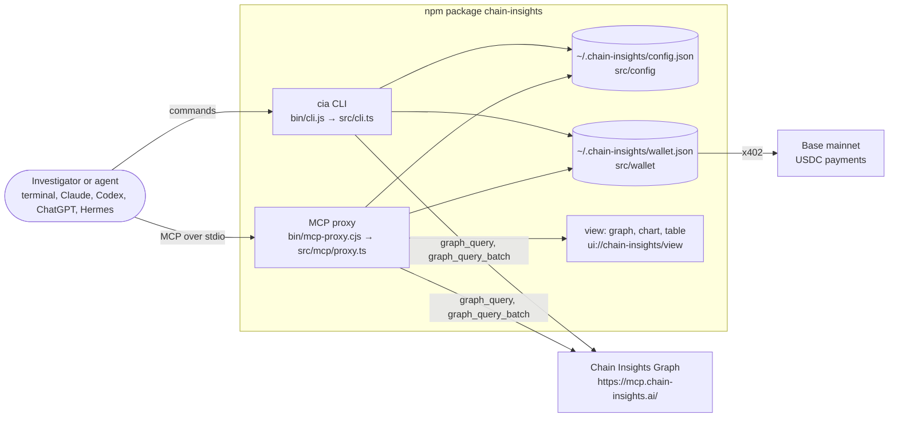

# chain-insights Architecture

[Website](https://chain-insights.ai) | [npm](https://www.npmjs.com/package/chain-insights)

Chain Insights is one npm package with two entry points: the `cia` CLI and the
stdio MCP proxy. Both read the same local config and wallet, and both reach
the hosted Chain Insights Graph for data. Nothing in this package indexes a
chain, stores a graph or scores risk.

Overview, config keys, local data and the security model:
[../architecture.md](../architecture.md). The contracts the code keeps (tool
surface, argument allowlists, endpoint precedence, the shared-graph model):
[../development.md](../development.md#contracts-the-code-keeps). Repository
rules and CI gotchas: [../contributing.md](../contributing.md#repository-rules).

## Containers

- [cia CLI](containers/cia-cli.md) — configuration, graph tool calls, wallet
  operations, agent setup.
- [MCP proxy](containers/mcp-proxy.md) — the stdio server agent clients
  connect to; serves the local tools and the view, proxies the graph tools.
- [npm package](containers/npm-package.md) — what ships: bins, `dist/`,
  `docs/*.md`, the `chain-insights-cypher` skill.

## Components

One doc per source module under `components/`. Human-authored.

| Module          | Entrypoint          | Component doc                                |
| --------------- | ------------------- | -------------------------------------------- |
| `config`        | `src/config`        | [config](components/config.md)               |
| `investigation` | `src/investigation` | [investigation](components/investigation.md) |
| `mcp`           | `src/mcp`           | [mcp](components/mcp.md)                     |
| `wallet`        | `src/wallet`        | [wallet](components/wallet.md)               |

Acceptance scenarios per component: [../acceptance/](../acceptance/config.md).

## Verification

- `npm test` — the suite, including `tests/docs-sync.test.ts`, which fails
  when these docs drift from the code.
- `npm run build`
