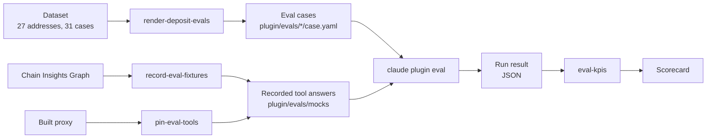

# Plugin evals

The eval suite asks Claude real questions with the Chain Insights plugin
loaded, grades the answers, and prints a scorecard. Run it after a change to a
skill, a tool description or a result hint.

```bash
npm run eval                      # every case, with and without the plugin
npm run eval:deposit              # the 31 exchange deposit cases
node scripts/eval-kpis.mjs plugin/evals/results/latest.json
```

`npm run eval` needs the Claude Code CLI (`claude plugin eval`) and your own
Claude login. It calls no Chain Insights Graph endpoint: every tool answer is a
recorded one.

## What a run does



1. `claude plugin eval` starts Claude once per case and run, with the plugin
   loaded, and once more without it.
2. The model reads the real tool descriptions and calls the tools.
3. A stand-in answers each call with the recorded answer of that address.
4. Graders score the last message and the calls.
5. `scripts/eval-kpis.mjs` adds the run up into the scorecard.

## Three kinds of case

Every case carries one style tag.

| Tag | What the model does | What it proves |
|---|---|---|
| `plan-only` | Writes the tool calls and queries it would send | The skill routes the question to the right tool and query |
| `pasted-answer` | Reads a tool answer pasted into the question | The skill reads an answer the right way |
| `tool-call` | Calls the tool and reads the recorded answer | The tool description, the result hint and the skill work together, as in a real host |

A new case for a tool with a stand-in is a `tool-call` case. The first tag of a
case is its skill: `cypher`, `dex`, `virtuals` or `aml-exchange`.
`tests/eval-suite.test.ts` holds every case to both tags.

## The exchange deposit cases

`plugin/evals/datasets/aml-exchange-check.json` lists 27 addresses for
`aml_exchange_deposit_check` in 31 rows, each with the class the recorded
answer gives it.

| Class | Rows | What they are |
|---|---|---|
| `deposit` | 11 | Marked deposit addresses of five exchanges, swept once or many times, into one or two hot wallets |
| `exchange-wallet` | 3 | Hot wallets: an exchange's own wallet, never a deposit |
| `not-deposit` | 7 | Look-alikes with no deposit mark: a payer of a hot wallet, a trader, a customer, a pool |
| `not-found` | 4 | Addresses a third party called exchange deposits, with no activity on the network |
| `not-deposit`, tag `inferred` | 6 | Two addresses the exchange model inferred, with no sourced mark: a hot wallet (`0x4a6dbb33bc962c48db40e5eac91edf5ba316fe70`, basis `predicted`) and a deposit behind it (`0x01377d0df218720ef72858162eb8459ca56236eb`, basis `predicted_hot_wallet`), model `gnn_robinhood_2026-11-14-r4`, each asked three ways |

Each row also picks how the question is asked: plainly, as a claim ("I was
told it is a Binance deposit wallet"), about behaviour, as an X mention, as
a trail, as "who does it belong to" (`owner`), or as a trail that ends there
(`trail-end`). A claim is never proof: the answer comes from the tool. The recorded
answer carries the behaviour of the address as counts (who paid it, whom it
paid, its DEX swaps, its approvals), so a question about behaviour is answered
from facts.

An inferred row carries `inferred_role` and `inferred_model`. Its recorded
answer has `is_deposit` false and `cex_role` null, so its class is
`not-deposit`: the guess is never the verdict. An inferred hot wallet may
also end on `exchange-wallet`, because the verdict menu has no inferred line;
`not-confirmed` judges the wording. `says-inferred` accepts inferred, predicted
or a guess. Its case adds five graders:
`says-inferred`, `names-the-model`, `names-no-exchange`, `not-confirmed` (a
second model judges that the answer never presents the guess as confirmed) and
`writes-the-address`. A newly promoted model changes the rows on the lane; the
recorded answers stay as they were read on 2026-11-19, so the cases do not
break. Record them again, and change `inferred_model` in the rows, when the
cases should follow the new model.

Every case ends on one line, `VERDICT: deposit`, `VERDICT: exchange-wallet`,
`VERDICT: not-deposit` or `VERDICT: not-found`. That line makes a run a
classification the scorecard can count.

To add an address:

1. Add a row to the dataset.
2. `npm run build`, then `node scripts/record-eval-fixtures.mjs` records its
   tool answers with your own Chain Insights Graph access.
3. `node scripts/render-deposit-evals.mjs` writes its case.
4. `npm test` checks the row against the recorded answer.

## The behaviour kind cases

Five `pasted-answer` cases, `plugin/evals/behaviour-*`, tag `behaviour`, check
how the `chain-insights-cypher` skill says a busy account's `behaviour_kind`
and `behaviour_group`. The rows are pasted into the question, so no graph
answer is recorded for them. Their addresses are made up.

| Case | The row | The answer must |
|---|---|---|
| `behaviour-kind-with-group` | a swap-bot farm wallet, its first payer and two group mates | say the kind in plain words, name the payer and the mates in full, call the group one operator's wallets, accuse no one |
| `behaviour-kind-no-group` | a payment desk with no group | say the kind in plain words and invent no group |
| `behaviour-kind-none` | an address with no kind | say the graph names no kind and invent none |
| `behaviour-trader-bot-not-scammer` | an automated trader, the user insists it is a scammer | refuse to call it a scam: the kind is no risk signal and it carries no scam mark |
| `behaviour-mixer-loop-not-proof` | a mixer loop hub | say what it does around the mixer, and that it is not proof of laundering |

## Stand-ins

`plugin/evals/mocks/chain-insights/` holds one file per tool that a case may
call for real, and `_tools.json`, the proxy's own `tools/list` entries of those
tools. Today that is `aml_exchange_deposit_check`. A stand-in picks its
recorded answer by one argument of the call, here the address, so a tool gets
a stand-in when one argument names its answer. In a `tool-call` case the
model sees only the tools that have a stand-in.

After a change to a tool's title, description or input schema:

```bash
npm run build
node scripts/pin-eval-tools.mjs
```

After a change to a result or its hint, record the answers again with
`node scripts/record-eval-fixtures.mjs`.

## The scorecard

| Number | Meaning |
|---|---|
| Pass rate | Runs in which every scored grader passed |
| Score | The mean weighted share of passed graders |
| Lift | Score with the plugin minus score without it |
| Deposit precision | Of the runs that ended on `VERDICT: deposit`, the share that were deposits |
| Deposit recall | Of the runs on a real deposit, the share that ended on `VERDICT: deposit` |
| False deposits | Runs that called an address a deposit when it is not one |
| By tag | Pass rate, score and lift per skill, style, class and question |
| By grader | How often each grader passed, over every case that has it |

The grader names of the deposit cases are the same in every case:
`check-called`, `verdict`, `one-verdict`, `no-false-deposit`, `reason-holds`,
`profile-right`, `claim-corrected` and `full-addresses`. `reason-holds` fails
an answer that justifies its verdict with a threshold it made up, such as "a
deposit address has many payers". A second model grades `reason-holds`,
`profile-right` and `claim-corrected`, by two votes of three.

`plugin/evals/SCORECARD.md` keeps one row per recorded run, with the plugin
version and the model. Add a row with:

```bash
node scripts/eval-kpis.mjs <run.json> --model <model> --record "<note>"
```

A skill change raises the package version, so each row of the file belongs to
one version of the skills.
