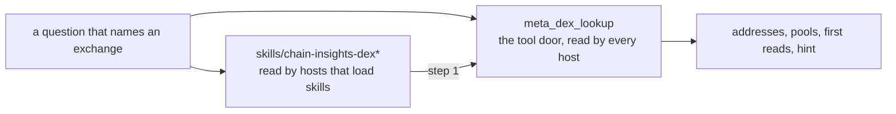

# MCP Proxy

The Chain Insights stdio proxy lets AI agents consume Chain Insights tools as
an MCP server. It connects to the configured Chain Insights Graph endpoint and
adds local wallet behavior.

## Basic Configuration

Use this MCP server configuration:

```json
{
  "mcpServers": {
    "chain-insights": {
      "command": "chain-insights-mcp-proxy"
    }
  }
}
```

The proxy reads the same local Chain Insights config as the CLI.

## Chain Insights Graph Endpoint Configuration

The endpoint lives in Chain Insights config, not in the MCP client registration.
The npm package defaults to public production:
`https://mcp.chain-insights.ai/` (host root, no `/mcp` path). A fresh install
can use `cia networks` without endpoint setup. MCP client JSON does not carry
the endpoint; use Chain Insights config for the default or an override.

Set local development:

```bash
cia config set graphMcpEndpoint http://127.0.0.1:8012/mcp
```

Set public production:

```bash
cia config set graphMcpEndpoint https://mcp.chain-insights.ai/
```

Use a one-shot environment override:

```bash
export CHAIN_INSIGHTS_GRAPH_MCP_ENDPOINT=https://mcp.chain-insights.ai/
```

Configuration precedence:

1. `CHAIN_INSIGHTS_GRAPH_MCP_ENDPOINT`
2. `GRAPH_MCP_ENDPOINT` legacy alias
3. saved `graphMcpEndpoint`
4. hosted production default `https://mcp.chain-insights.ai/`

Validation rules:

- local `http://` is accepted only for localhost and loopback addresses
- remote endpoints must use `https://`
- endpoint URLs with credentials, query strings, or fragments are rejected

Keep endpoint overrides in operator config or environment variables. Do not
put endpoint configuration in MCP client JSON.

## Behavior

The proxy:

- Connects to `graphMcpEndpoint`.
- Uses debug bearer auth, test access key auth, or x402 payment auth according
  to local config.
- Caches remote tool schemas per endpoint for 24 hours.
- Exposes graph tools returned by the endpoint.
- Adds local `meta_*` and `wallet_*` tools.
- Publishes instructions with required argument rules, workflow guidance, and
  schema hints.

## Local Tools

| Tool                        | Purpose                                                                              |
| --------------------------- | ------------------------------------------------------------------------------------ |
| `meta_network_capabilities` | Show the current Chain Insights network/tool support matrix                          |
| `meta_schema`               | Show the live graph schema of a network: labels, link types, fields, indexes         |
| `meta_dex_lookup`           | Turn an exchange name into its factories, routers or manager, pools and first reads  |
| `meta_rules`                | Read the answer rules when the `chain-insights-cypher` skill is not loaded           |
| `meta_help`                 | Show Chain Insights tool and workflow guidance                                       |
| `meta_usage_status`         | Check the caller's daily free-tier graph query allowance                             |
| `meta_subscription_status`  | Check the caller's $CIA subscription window and allowance                            |
| `wallet_balance`            | Show the local payment wallet address, payment network, token, and amount            |
| `wallet_topup`              | Show the local payment wallet address and its QR code, with a Claude view            |
| `graph_expand`              | Expand a node or list a link's transfers in an open picture; called by the view only |

`meta_schema` reads the live graph schema of one network: the labels, the link
types, every property key, the indexes, the fields of an address and of each
main link, the `USE facts` relationships with the `TRANSFER` columns, and the
`USE chain` lookups. It takes `network` (required) and `refresh` (optional).
The answer is cached on disk for 24 hours under `~/.chain-insights/cache/`, one
file for each network and endpoint. A build reads through the one remote
session of the proxy. A read that fails leaves its section empty and adds a
note, and such a schema is kept for 10 minutes, not 24 hours. In the terminal,
`cia network robinhood --schema` prints the same schema, with `--json` for the
structured form and `--refresh` to rebuild it.
`cia mcp call meta_schema network=robinhood` does the same.

`meta_dex_lookup` turns the name of a decentralized exchange, a launchpad or a
vault into its addresses. It takes `network` (required), `name` (optional:
with no name it lists every covered exchange) and `pools` (default `true`).

1. The name is matched against the exchange registry,
   [`registry/robinhood.json`](../registry/robinhood.json): exact on the key,
   the display name and the aliases, then within two letters of an alias of
   four or more characters. One winner is `matched`; a misspelling is named in
   `took_for`. A tie is listed in `candidates`, never guessed. No hit returns
   `covered`, every covered exchange, and sends no graph read.
2. For a match, one `graph_query_batch` reads `Head` for the three family
   lags, each factory, manager and router by its address (`confirmed` is true
   when the graph shows a contract), and the ten biggest pools each factory
   deployed. It is billed as any read; the match itself costs nothing.
   `pools: false` drops the pool reads.
3. The answer carries `recipe`, the first reads of the exchange's trail type
   with its addresses filled in, and the answer `hint` every graph reply
   carries.

The registry is read from the public file on `main`,
`https://raw.githubusercontent.com/chainswarm/chain-insights/main/registry/<network>.json`,
within 3 seconds, and cached for one hour in
`~/.chain-insights/cache/dex-registry-<network>.json` (mode 0600). When the
fetch fails, the stale cache answers; with no cache, the copy packaged with
the installed version does. A malformed public file never replaces a good
cache. `registry_source` in the answer says which copy answered: `fetched`,
`cached` or `packaged`. `CHAIN_INSIGHTS_DEX_REGISTRY_URL` points the fetch
somewhere else, for tests and the lab; `{network}` in it is filled in.

## Host parity

**A rule a host never loads does not exist for that host.** Each host loads a
different part of what this package ships:

| What a host loads | Claude Code | Desktop Code mode | Codex | Hermes | scout agent | Desktop chat / claude.ai |
|---|---|---|---|---|---|---|
| skill files (`cia setup`) | yes | yes | yes | yes | copied, 2 of 6 | no |
| server instructions | yes | yes | yes | yes | yes | no (ignored) |
| `meta_rules` | yes | yes | yes | yes | yes | no (never called) |
| tool descriptions | yes | yes | yes | yes | yes | yes |
| result `hint` | yes | yes | yes | yes | yes | yes |
| protocol tool doors | yes | yes | yes | yes | yes | yes |

The scout agent pins the CLI by version in its image and copies only
`chain-insights-cypher` and `chain-insights-virtuals` into its project, yet asks
an exchange question by name every run. Until 0.69.0 that question ran with no
exchange skill: the same gap as Desktop chat. From 0.69.0 the door answers it.



The rule:

1. A protocol skill ships with a tool door: frontmatter `door: <tool>`.
2. The door's description carries the rule the skill opens with, and names
   the skill's trigger words.
3. The skill names the door as its first step.

A host that loads skills gets both. A host that loads none gets the door.
`tests/host-parity.test.ts` checks it: every
`skills/chain-insights-<protocol>/SKILL.md` has a door, the door is in
`LOCAL_TOOL_NAMES` of `src/mcp/proxy.ts`, and its description names the
skill's trigger words. The core skill `chain-insights-cypher` is exempt: its
door is `meta_rules` plus the `graph_query` description.

## Views in Claude

Claude Desktop and Cowork sessions on your computer draw MCP Apps views next
to a tool answer. The local proxy serves every view itself. The Chain Insights
Graph endpoint serves data only:

- `ui://chain-insights/view` is one HTML file shipped in the package. It draws
  a `graph_query` answer from its column names: rows with `from_address` and
  `to_address` columns draw a graph (optional columns: `amount_usd_sum`,
  `tx_count`, `first_seen_timestamp`, `last_seen_timestamp`, `link_kind`,
  `from_labels`, `to_labels`, `from_is_exchange`, `to_is_exchange`; the list is
  `src/mcp/graph-row-columns.ts`, and `tests/graph-row-columns.test.ts` holds
  the view, the hint and the recipes to it), rows with a `day`, `date` or `*_timestamp` column
  and number columns draw a chart, and any other rows draw a table. It also
  draws the balance for `meta_usage_status` and `meta_subscription_status`.
  Nothing is fetched at run time. The proxy has no tool that composes a picture
  for the model: the model writes its own `graph_query`.
- In the money flow graph, one click on an address shows its details in the
  side panel; a double click (or Shift+Enter) loads its senders and receivers
  and rings the address, and a second double click folds them back. A click on
  a link shows its details and its transfers in pages of 25 in the same panel;
  the other links dim and come back with a click on the empty canvas. Gravity
  is the first layout, and an expansion settles around the address that was
  opened; Tree (senders left, receivers right, newest activity first) is one
  click away. The table follows the drawing, expansions included. Reset
  returns to the first answer. Outside the drawing, addresses are shown in
  full.
- `graph_expand` runs on your computer and answers the clicks in a picture. It
  takes `{network, address, in_offset?, out_offset?}` to load the newest senders
  and receivers of one address, up to 250 a side. That is at most five anchored
  topology `graph_query` reads: the node, then two reads a side, because one
  reply holds at most 200 rows. A side that ends early skips its second read.
  A busy address shows fewer, so the answer stays under 140,000 characters.
  The answer says how many senders and receivers are not loaded yet. Or it takes
  `{network, from, to, day}` to list the transfers between two addresses on one
  UTC day, newest first, at most 50 (one `USE facts` `graph_query` read). With
  `limit` (1 to 50), and `skip` and `first_day` as the answer's `next` cursor
  hands them back, it lists a page of transfers from that day back across
  days, at most seven facts reads (a week) a call, never before `first_day`; the view's
  "More transfers". With `{network, address, details: true}` it answers the
  lifetime totals, counts, role and labels of one address in one topology
  read; the view fills its panel with it when the rows of a query carried no
  totals. Each read is billed as a graph query. A malformed address, a
  malformed day, a limit outside 1 to 50 or an offset over 10,000 is refused
  before any read and costs nothing.
- `graph_expand` carries `_meta.ui.visibility` `["app"]`: the view calls it,
  and hosts keep it out of the model's tool list.
- The endpoint's own `ui://` resources and `_meta.ui` are not forwarded.
- The answers of `graph_query` and `graph_query_batch` keep their
  `structuredContent` exactly as the endpoint returned it.
- `wallet_topup` draws `ui://chain-insights/topup`: the wallet address, its QR
  code, Base Mainnet and USDC, in Claude's light or dark theme. The view signs
  nothing and sends nothing. Only the local proxy offers it.

Claude Code draws no views. Every tool answers in full as text.

Remote graph tools are discovered from the configured Chain Insights Graph endpoint.
The minimum graph primitive surface is `graph_query` and `graph_query_batch`;
backends can also expose capability metadata such as `network_capabilities`.
Chain Insights presents this as local, prefixed metadata through
`meta_network_capabilities`.

The CLI keeps these catalogs distinct: `cia workflows` lists high-level CIA
workflow tools, while `cia mcp tools` lists remote GraphRAG tools and caches
that schema for 24 hours. `cia networks` reports the network list.
`cia mcp networks` exposes the full network capability matrix, with each
network's advertised remote tools. Use `cia mcp tools --refresh` after a
backend tool change.

`cia network <name>` shows how far one network is indexed:

```text
$ cia network robinhood
Network           Robinhood Chain
Identifier        robinhood
Status            live (default)
Blockchain head   87,642,448  (1 s old)

Indexing                      height      behind head
  receipts                    87,642,307          141
  traces                      87,641,751          697
  dex                         11,959,694   75,682,754
  bridge                      87,641,751          697
  smart accounts              87,641,751          697

Graph                         height      behind head
  flows                       87,641,751          697
  operated_by                 87,642,307          141
  dex_swaps                   87,312,173      330,275
  dex_liquidity               87,312,173      330,275
  bridged                     87,641,751          697
  approvals                   87,642,307          141
  sponsored                   87,641,703          745
  bundled                     87,641,751          697
  signers                     87,641,703          745
  owners                      87,641,751          697
  contracts                   87,641,751          697

Evidence                      height      behind head
  evidence                    not reported
```

- `Blockchain head` is the newest block the chain node holds, and how old that
  reading is. Every other number reads against it.
- `Indexing` is the raw chain data: receipts, traces, dex, bridge and smart
  accounts. `Graph` is each link kind of the topology graph. `Evidence` is the
  evidence index.
- `height` is the block each one has reached. `behind head` is the head minus
  that height.
- `not started` means that data has not begun. `not reported` means the
  network does not report it yet.
- `--json` prints the network's reply unchanged.

Use `cia mcp call graph_query` or `cia mcp call graph_query_batch` for
agent-authored graph reads.

`meta_usage_status` is a Chain Insights proxy tool. On hosted Chain Insights Graph
backends it can reflect remote quota telemetry. On backends without a quota
tool, it returns a local unmetered primitive-backend status.

Graph queries take full blockchain addresses directly and return blockchain
addresses as the public result surface. The graph is address-grain, so there
is no identity-resolution step. Never shorten an address.

The proxy does not offer `aml_address_risk`. It is hidden until its verdict is
fixed: `tools/list` omits it, and a call to it is refused as an unknown tool.

## Auth Modes

Local debug mode:

```bash
cia debug on --token chain-insights-dev-debug --endpoint http://localhost:8012/mcp
cia mcp tools --refresh
```

Invited tester access key mode:

```bash
cia access-key set ci_test_REDACTED --endpoint https://mcp.chain-insights.ai/
cia access-key status
```

Daily free-tier graph usage:

```bash
cia mcp call meta_usage_status
cia mcp call graph_query \
  network=robinhood \
  "query=USE topology MATCH (n) RETURN count(n) AS count LIMIT 1"
```

Hosted Chain Insights Graph can allow anonymous `graph_query` and
`graph_query_batch` calls before wallet setup. The free tier is 5,000 units a
day per address (an IP address block), at 30 requests a minute, reset at
midnight UTC. A unit is one returned row, node, edge or list element.
Schema reads (`meta_schema`) cost nothing on every door.
`meta_usage_status` returns only the current caller's allowance status.
Wallet users receive the same free tier first; after it is exhausted, x402
payment continues automatically when `wallet ready` reports ready.

The free tier includes `graph_query_batch`. Pay as you go on x402 (and the ACP
offering) costs one cent per 100 units, rounded up to the next cent, with one
cent minimum per call; a batch is one call. It has no daily limit and no rate
limit for paying agents. A subscription in $CIA (not yet live) gives 100,000
units a day at 60 requests a minute. Use explicit LIMIT and pagination in your
query when you want bounded result sets.

### CLI Output And Tool Versions

The CLI renders JSON graph results as a readable summary and table by default.
Use `--json` for indented machine-readable output:

```bash
cia mcp call graph_query \
  network=robinhood \
  "query=USE topology MATCH (a:Address) RETURN a.address AS address LIMIT 10"

cia mcp call --json graph_query \
  network=robinhood \
  "query=USE topology MATCH (a:Address) RETURN a.address AS address LIMIT 10"
```

For graph reads, install `chain-insights-cypher`. It teaches ISO GQL, the
three read layers, one query for each kind of graph search, and how to find
the fields of the graph.

Paid x402 mode:

```bash
cia config set graphMcpEndpoint https://mcp.chain-insights.ai/
cia debug off
cia wallet create
# Save the private key, then type BACKED UP when prompted.
cia wallet topup
cia wallet ready
```

To use an existing wallet instead:

```bash
cia wallet import 0xYOUR_EVM_PRIVATE_KEY
cia wallet ready
```

If `graphMcpAuthToken` is set, Chain Insights sends both
`X-MCP-Debug-Token` and `Authorization: Bearer <token>`. If it is empty,
Chain Insights uses the encrypted wallet private key with x402 payment
handling. `wallet ready` is the user-facing preflight: it checks Base USDC,
Base ETH gas, and one-time payment setup. A normal user does not need payment
protocol details; run `cia wallet ready` and retry the paid tool
after it reports ready.

## Agent Installers

Install skills and MCP registration:

```bash
cia --claude
cia --codex
cia --hermes
```

The Hermes installer writes Chain Insights skills under the Hermes skills
directory and registers the stdio MCP proxy in the Hermes config.

For graph-language work, agents use `chain-insights-cypher`. A protocol
skill such as `chain-insights-virtuals` is installed beside it and loads only
when a question names its protocol.

## Supported Agent Setup

The supported setup targets are the same ones advertised by top-level installer
flags:

```bash
cia setup claude-code
cia setup claude-desktop
cia setup codex
cia setup chatgpt
cia setup hermes
```

`cia setup chatgpt` sets up the ChatGPT desktop app: its Codex chats run
Chain Insights. Ask there, not in a plain ChatGPT chat.

`cia setup claude` is an alias for `cia setup
claude-code`. `cia setup claude-desktop` writes the proxy into Claude
Desktop's `claude_desktop_config.json`, keeps every other entry, saves a
`.bak` copy, and refuses a file that is not valid JSON. Restart Claude
Desktop afterwards.

`cia setup codex` installs the Chain Insights Codex plugin: a local
one-plugin marketplace under `~/.chain-insights/codex-marketplace`, registered
in `~/.codex/config.toml` as `chain-insights@chain-insights`, with the skills
copied to `~/.codex/skills`. The Codex app draws the graph, chart and table
views only for a server that a plugin provides, so the plain
`[mcp_servers.chain-insights]` entry that earlier versions wrote is removed.
Every other entry in `config.toml` is kept. When the `codex` command is on
`PATH`, setup also runs `codex plugin add chain-insights@chain-insights`;
otherwise run it once yourself. Restart the Codex app afterwards. To remove
the plugin: `codex plugin remove chain-insights@chain-insights`, then
`codex plugin marketplace remove chain-insights`.

Current MCP prompts exposed by the local proxy:

- `meta-network-capabilities`
- `meta-schema`
- `meta-usage-status`
- `meta-subscription-status`
- `graph-query`
- `graph-query-batch`
- `wallet-balance`
- `meta-help`

Prompts use the current supported investigation network internally so Inspector
does not render a free-text network field. Tool calls still expose `network` as
an enum input where the Inspector can render a dropdown.

Useful prompt text:

```text
Use Chain Insights `meta_network_capabilities`. Report the supported networks and
available tools exactly as returned.
```

```text
Use Chain Insights graph_query on network robinhood with:
USE topology MATCH (a:Address)
RETURN a.address AS address, a.network AS network, a.labels AS labels
LIMIT 10
```

```text
Use Chain Insights graph_query_batch on network robinhood with these read-only Cypher queries:
1. USE topology MATCH (a:Address) RETURN count(a) AS count LIMIT 1
2. USE topology MATCH (src:Address)-[f:FLOWED_TO]->(dst:Address) RETURN src.address AS source, dst.address AS target, f.amount_usd_sum AS amount_usd_sum LIMIT 3
```

```text
Use Chain Insights `wallet_balance`. Show the wallet address, payment network,
token, and amount exactly as returned.
```

## Inspector Validation

Inspect a local Chain Insights Graph endpoint directly:

```bash
npx @modelcontextprotocol/inspector \
  --cli http://localhost:8012/mcp \
  --transport http \
  --method tools/list \
  --header "X-MCP-Debug-Token: chain-insights-dev-debug"
```

Inspect the local Chain Insights proxy:

```bash
npx @modelcontextprotocol/inspector \
  --cli chain-insights-mcp-proxy \
  --method tools/list
```
