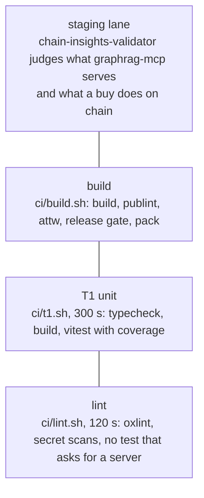

# Chain Insights testing

Two checks before a merge, the build before a release, then the staging
lane (AP1000 change `validator-agents-replace-integration-tests`, 2026-11-20).
No test here asks for a server or a chain node.



## Commands

On the workstation every test run goes through AP1000's test sandbox
(`test-sandbox.sh`), so no test reads or writes the real home:

```bash
bash ci/lint.sh
bash "$AP1000_SANDBOX" <worktree> -- bash ci/t1.sh   # AP1000 test-sandbox.sh
```

The risk golden runner asks the risk tools about known addresses, pools and
tokens on a live graph. It is not a test of T1 and is not in the package;
its compare rule is (`tests/risk-golden-compare.test.ts`):

```bash
RISK_GOLDEN_TOKEN_FILE=<file> npx tsx scripts/risk-golden.mjs token --json > evidence.json
```

The cases live in `scripts/risk-golden.json`. Each names only the expect keys
it checks. A count that grows with the chain is a `*_min` key: a token's pool
count is `pools_found_min`, never an exact `pools_found`. A run fails when a case fails or the set holds fewer cases than
`--min` (20 address, 10 pool, 20 token by default).

`.github/workflows/verify.yml` runs the same files, by hand and before a
release. No pull request runs a test. There is no start-up smoke: the
package runs no StarRocks.

## Where a new test goes

| The code | The test |
|---|---|
| a rule, a query builder, a tool's text, a registry file | a unit test in `tests/`, over committed fixtures |
| a step that talks to the chain or to `graphrag-mcp` | a unit test of its own decisions over the answers it is given (`tests/subscription-buy.test.ts`); what the other side does is judged on the staging lane |
| what a lane serves | a check of chain-insights-validator. Name it in the pull request |

`ci/lint.sh` refuses:

- a `*.integration.test.ts` or `*.t2.test.ts` file;
- a test that reads a live-graph endpoint setting, the retired T2 switch,
  `ANVIL_BIN` or `STARROCKS_*`, or starts anvil.

## What the staging lane judges

chain-insights-validator must gain these checks (none exists yet; its one
check today is `daily_run`):

- **Exchange registry.** Every row of `registry/robinhood.json` against the
  lane's graph: every factory, manager and router is a contract; every
  factory with a pool floor deployed at least that many pools; every example
  pool is `:Pool`, carries one of its row's adapter marks, and was deployed by
  one of its factories.
- **Golden marks.** Every row of `tests/fixtures/graph-marks-golden.json`:
  every golden mark present, every forbidden mark absent, every count at least
  its floor, the card subset held (`lane_only: "staging"` rows on the staging
  lane only).
- **Documented recipes.** Every recipe of `tests/fixtures/documented-recipes.json`
  and every query of `tests/fixtures/graph-query-corpus.json` is admitted or
  refused as documented, fixture-anchored recipes return rows under their
  `RETURN` aliases, and every address column is a lower-case `0x` address.
- **Subscription buys.** Every `Received` event of the sink
  `0x67a8c068cc762e371706ea6c399178171f92810d` on Robinhood Chain is from
  the paying wallet, for the exact amount, and becomes a grant.
