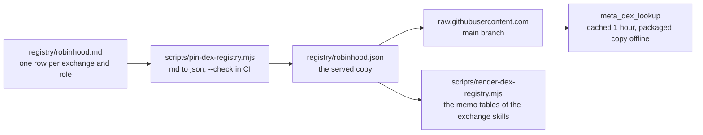

# The exchange registry

**One reviewed table per network names every decentralized exchange and its
factory, manager and router contracts.** A user names an exchange (Aero,
Uniswap), not a factory address. This folder is the one home of name to
addresses. The proxy tool `meta_dex_lookup` serves it to every host.



## The files

| File | Rows served | Why |
|---|---|---|
| [robinhood.md](robinhood.md) | 44 | registry version 2, recorded 2026-10-24; the one `dyor` row is not served |
| [robinhood.json](robinhood.json) | 29 exchanges | the served copy of `robinhood.md`, never edited by hand |

A change to the rows merged on `main` reaches every running proxy within one
hour. No release is needed for a data change.

## The review rule

1. **No source link, no row.** Every row carries the one link that confirms
   it. Pin the link to a commit where the source has one.
2. **No chain check, no serve.** A row is served only when the chain's own
   data shows the address does what its role says:
   - `factory`: a contract that created pools;
   - `manager`: a contract that holds pools;
   - `router`: a contract that forwards swaps.
   Write the check into the file's `## Verification` section.
3. **An unchecked row stays in the table.** Its verification cell says
   `not served:` and the reason. It is served later, when a check passes.
4. **The chain wins over the source.** When the chain shows a different
   factory or block than the source, the row follows the chain and the file
   says so.
5. **An exchange needs a pool row.** An exchange with no served row of role
   `factory` or `manager` is refused whole, router rows included.
6. **One key per exchange.** A second spelling is an alias, never a second
   key. Two exchanges may share an alias only when a user's word fits both
   (`Balancer`): the lookup then lists both and guesses neither.

## The columns

The `## Rows` table has twelve columns, in this order.

| Column | Means |
|---|---|
| dex | the key as a user says it, in lowercase: `aero`, `uniswap-v4`. Letters, digits, `.`, `_` and `-`, at most 32 |
| display | the exchange name as a reader sees it, at most 96 characters. Every row of an exchange carries the same display |
| aliases | the names a user types, comma separated, on one row of the exchange or spread over several |
| trail type | how money is traced through the exchange: `plain`, `vault`, `gauge` or `launchpad`. Every row of an exchange carries the same trail type |
| adapter | the adapter id of the DEX indexer that reads the row's pools: `cl-gauge-v1`, `uniswap-v4` |
| role | `factory` creates pools, `manager` holds pools, `router` forwards swaps |
| address | lowercase `0x` hex in backticks |
| valid from block | the first block the row holds from, `0` when it is not known yet |
| example pool | optional: one pool of the exchange, read live by the release suite. Empty or `-` when not given |
| pool floor | optional: the least number of pools the exchange must show on a lane. Empty or `-` when not given |
| source link | the one link that confirms the row, as `[text](https://…)` |
| verification | `served`, or `not served:` and the reason |

Each network file states `Registry version: N`. Bump it in every change to
the rows. Each file also states `Recorded on: YYYY-MM-DD`, the day of the
last row change. The pin script copies both into the served copy.

A row is refused for one of these reasons:

| Reason | When |
|---|---|
| `malformed row` | the row has the wrong number of cells, or no display |
| `duplicate row` | the same key, role and address twice |
| `bad dex key` | the key is not lowercase letters, digits, `.`, `_` or `-` |
| `bad address` | the address is not lowercase `0x` and 40 hex digits |
| `unknown role` | the role is not `factory`, `manager` or `router` |
| `unknown trail type` | the trail type is not `plain`, `vault`, `gauge` or `launchpad` |
| `bad adapter` | the adapter is empty or not an id |
| `no source link` | the source link is not `[text](https://…)` |
| `bad block`, `bad example pool`, `bad pool floor` | the cell is not a number or a pool |
| `too long` | a value does not fit its column |
| `dex rows disagree` | two rows of one exchange give a different display, trail type, example pool or pool floor |
| `no factory or manager row for the dex` | the exchange has router rows only |

## The check

Regenerate the served copy after a row change:

```bash
node scripts/pin-dex-registry.mjs registry/robinhood.md
```

Check that the committed copy is what the file gives. CI runs this on every
pull request:

```bash
node scripts/pin-dex-registry.mjs --check registry/robinhood.md
```

It prints `rows: N served, M refused, K not served` and
`registry/robinhood.json up to date, registry version V`. It exits 1 when a
row is refused or the committed copy differs, and names both versions.

The skill memo follows the served copy:

```bash
node scripts/render-dex-registry.mjs          # rewrite the memo tables
node scripts/render-dex-registry.mjs --check   # exit 1 when a memo table differs
```

## The served copy

`registry/<network>.json` has the schema `chain-insights.dex-registry.v1`:

- one entry per exchange, in the order the file first names it;
- `factories` lists its `factory` and `manager` addresses, `routers` its
  `router` addresses; an exchange with no router row lists its manager there,
  because a vault forwards its own swaps;
- `adapters`, `since_block` and `source` come from the factory and manager
  rows: every adapter in order, the lowest block, the first source;
- `example_pool` and `pool_floor` are `null` when the exchange gives none.

The release suite `tests/dex-registry-live.integration.test.ts` reads every
row against a live graph per release candidate: every factory, manager and
router is a contract, every factory with a pool floor shows at least that many
pools, and every example pool is a `:Pool` deployed by its factory.
